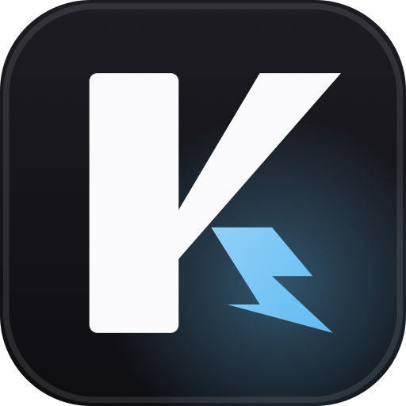

<p align="center">
  
</p>

<h1 align="center">KillX for macOS</h1>

<p align="center">
  Fast, minimal menubar companion to find, trace, and terminate listening ports, dev servers, and applications.
</p>

<p align="center">
  <a href="https://github.com/kiron0/killx/actions/workflows/ci.yml"></a>
  
  
  <a href="LICENSE"></a>
</p>

<p align="center">
  <a href="https://github.com/kiron0/killx/releases/latest">
    
  </a>
</p>

---

## Features

- **Ports Management (`Ports` tab)**:
  - Real-time inspection of active TCP listening ports (`:3000`, `:5173`, `:8080`, etc.).
  - Identify process names, PIDs, memory usage, and commands.
  - Kill single port listeners gracefully (`SIGTERM`) or hold <kbd>⌥ Option</kbd> for force kill (`SIGKILL`).
  - **Process Tree Killing (`--tree`)**: Terminate root supervisors (npm, yarn, pnpm, cargo, vite) and all child processes cleanly.
  - **Docker-Aware**: Detects Docker container port forwards and allows stopping containers gracefully.
- **Deep Process Trace (`killx trace`)**:
  - Interactive process tree visualizer detailing parent PIDs, PPIDs, working directories, and startup commands.
- **macOS Applications (`Apps` tab)**:
  - Inspect and quit running applications and background daemon processes.
  - Session stash and restore support.

---

## Install

1. Download the latest release `.dmg`.
2. Drag **KillX** into `/Applications`.
3. Launch from Applications or Spotlight. It lives in your menu bar.

---

## CLI Companion

KillX also includes a Node-based terminal CLI and Go CLI:

```bash
npm install -g killx
# or run directly
npx killx 3000
```

---

## License

MIT © [Toufiq Hasan Kiron](https://github.com/kiron0)
